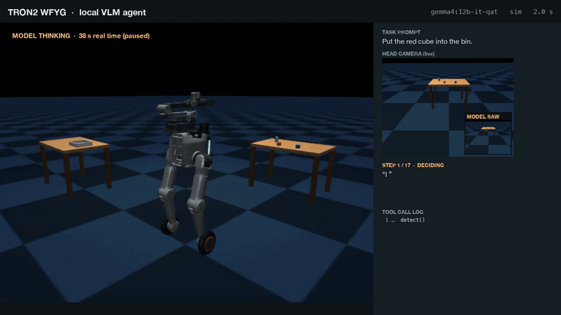

# agentic-locomanip

Agentic loco-manipulation in MuJoCo, demonstrated on the LimX TRON2 WFYG (wheel-legged base with one 6-DoF arm). A local vision-language model running in Ollama plans the task by calling robot tools. Everything runs on an Apple Silicon Mac (developed on an M4 with 16 GB), or on a Kaggle T4 GPU.



*"Put the red cube into the bin." gemma4:12b-it-qat on a Kaggle T4: 15 tool calls, none failed. Left: the robot. Right: what the model saw, its reason and the tool call log. Sped up 2x.*

**Run it yourself:** [Kaggle notebook: Agentic Loco-Manipulation with a Local VLM](https://www.kaggle.com/code/supatroongpraiwan/agentic-loco-manipulation-with-a-local-vlm) (free T4 GPU, about 30 min, no setup).

## Architecture

```
 instruction ──► Planner (local VLM via Ollama, default gemma4:12b-it-qat)
                   │  tool call (one per turn)            ▲ JSON result + head camera image
                   ▼                                       │
               Validator (schema, types, bounds) ──► Tools ┘
                                                   │  detect / rotate / navigate_to / move_eef / gripper ...
                                                   ▼
               Sim (MuJoCo, 1 kHz)
                 ├─ legs + wheels: LimX WF_TRON2A RL policy (ONNX, 50 Hz) taking (vx, wz) commands
                 ├─ base station keeping during manipulation
                 ├─ arm: damped least-squares IK + Cartesian servo, PD with gravity compensation
                 └─ gripper: force-limited PD
```

The planner never outputs motor commands, but it does all of the task reasoning. There is no pick, place or approach skill: the model reads positions from `detect`, works out where to stand, then hovers, lowers, closes, lifts and drops with `move_eef` and `gripper`. Each tool runs its own closed-loop control inside the simulator.

**Locomotion.** The legs run the pretrained `WF_TRON2A` policy from `limxdynamics/tron2_rl_deploy_python`. It was trained without an arm. It still balances the WFYG body (about 7 kg heavier), but the base drifts when the arm reaches out, so a position-hold loop runs during arm moves. `navigate_to` folds the arm before driving (a held object stays held).

**Perception.** `detect()` uses simulator ground truth, filtered to items inside the head camera's field of view. Items seen earlier are remembered. Objects and the bin come with their world position and closest table edge, tables with their x and y ranges. A held object is reported only as "in the gripper", so its coordinates cannot be mistaken for a place to go. Camera images go to the model for visual context.

**Manipulation.** The gripper always points straight down. The arm reaches 0.18 to 0.60 m in front of the base, at most 0.30 m to the side, from table height up to 0.40 m above it. Tool results are written to steer a small model: a rejected `navigate_to` names the valid range ("x must be <= 1.54"), `gripper("close")` reports what it grasped and where the bin is, and a release that misses the bin is reported as a failure.

## Tools

| Tool | Arguments | What it does |
|---|---|---|
| `detect` | | Items in view plus remembered items, with positions and closest table edge |
| `look` | `camera` (head, wrist) | Attach a camera image |
| `rotate` | `angle_deg` | Turn in place (positive is left). Search by turning 45 degrees the same way and calling `detect` |
| `navigate_to` | `x`, `y`, `yaw_deg` | Drive to a floor point, routing around tables. Must stay at least 0.15 m outside table edges |
| `move_eef` | `x`, `y`, `z`, `yaw_deg` | Move the gripper tip to a world point |
| `gripper` | `action` (open, close) | Open or close the gripper |
| `get_state` | | Base pose, held object, gripper opening |
| `done` | `success`, `summary` | End the episode |

With `--explain` every tool also takes a required `reason` string (one sentence), which the demo video shows.

## Layout

| Path | Contents |
|---|---|
| `src/agentic_locomanip/locomotion.py` | ONNX wheel-leg policy wrapper (observation layout matches LimX deploy code) |
| `src/agentic_locomanip/arm.py` | Arm IK |
| `src/agentic_locomanip/scene.py` | Scene: robot (coloured like the real TRON 2), two tables, cubes, can, bin, cameras |
| `src/agentic_locomanip/sim.py` | Physics loop and low-level control |
| `src/agentic_locomanip/skills.py` | Tool implementations |
| `src/agentic_locomanip/agent.py` | Tool schemas, system prompt, validator, Ollama and scripted planners, episode runner |
| `src/agentic_locomanip/tasks.py` | Tasks with ground-truth success checks |
| `src/agentic_locomanip/demo.py` | Annotated demo video from a recorded run |
| `src/agentic_locomanip/cli.py` | `agentic-locomanip run`, `eval` and `demo` |
| `scripts/fetch_assets.sh` | Downloads the LimX robot model and policy into `assets/` |
| `tools/kaggle/` | Kaggle notebook generator and upload script |
| `docs/` | README demo GIF |

## Setup

```bash
./scripts/fetch_assets.sh          # robot MJCF + meshes, WF policy (Apache-2.0, LimX Dynamics)
uv sync
ollama pull gemma4:12b-it-qat      # needs a recent Ollama (0.40+)
```

## Usage

```bash
uv run agentic-locomanip run --task red_to_bin --planner scripted --video   # no LLM, sanity check
uv run agentic-locomanip run --task red_to_bin --video --explain            # gemma4:12b-it-qat
uv run agentic-locomanip demo runs/<run dir>                                # annotated demo.mp4
uv run agentic-locomanip run --instruction "put the blue cube in the bin" --model qwen3-vl:8b-instruct
uv run agentic-locomanip eval --task two_cubes --episodes 2 --seed 10 --max-steps 50   # randomized scenes
uv run pytest
```

Each run writes `runs/<stamp>_<task>_<model>/` containing `trace.jsonl` (every tool call, result, reason and model latency), the camera images sent to the model, `result.json`, and with `--video` a chase-camera `video.mp4` plus `frames.json`.

`agentic-locomanip demo` turns a run recorded with `--video` into a 1280x720 video: the robot on the left, and on the right the prompt, the camera image the model saw, its reason, the tool call and the result. Model thinking time is shown as a 2.5 s pause per call and robot motion plays at 1.5x (`--think-s`, `--speed`).

## Kaggle

The public notebook [Agentic Loco-Manipulation with a Local VLM](https://www.kaggle.com/code/supatroongpraiwan/agentic-loco-manipulation-with-a-local-vlm) explains the setup, runs `red_to_bin` and `two_cubes` with gemma4:12b-it-qat on a T4 and renders both demo videos. To push your own copy:

```bash
uv run python tools/kaggle/push.py --user <kaggle-username>            # private
uv run python tools/kaggle/push.py --user <kaggle-username> --public   # public
```

The notebook (T4 GPU, internet on) clones this repo from GitHub, fetches the LimX assets, installs Ollama and pulls the model itself.

## Tasks

| Task | Instruction |
|---|---|
| `red_to_bin` | Put the red cube into the bin. |
| `blue_to_bin` | Find the blue cube and put it in the bin. |
| `can_to_bin` | Bring the green can to the bin. |
| `two_cubes` | Put both cubes (red and blue) into the bin. |

## Results

On a Kaggle T4, default scene:

| Planner | Task | Success | Tool calls | Failed calls | Wall time |
|---|---|---|---|---|---|
| `gemma4:12b-it-qat` | `red_to_bin` | yes | 15 | 0 | 9.6 min |
| `gemma4:12b-it-qat` | `two_cubes` | yes | 29 | 3 | 12.9 min |

Model calls take 2 to 30 s on the T4. The failed `two_cubes` calls were drop heights the arm could not reach; the model raised the height until they worked.

On an M4 (16 GB), randomized scenes (`--seed`, random start heading and object positions):

| Planner | Task | Success | Tool calls | Wall time per episode |
|---|---|---|---|---|
| `gemma4:12b-it-qat` | `red_to_bin` (seeds 10-12) | 3/3 | 17-20 | 9-55 min |
| `gemma4:12b-it-qat` | `two_cubes` (seeds 10-11) | 1/2 | 35 (success) | |
| `qwen3-vl:8b-instruct` | `red_to_bin` (default scene) | 0/5 | | |
| scripted (no LLM) | `red_to_bin`, `blue_to_bin`, `can_to_bin` (seeds 1-4) | 12/12 | 11 | ~4 s |

The failed `two_cubes` episode put the blue cube in the bin, then kept driving back to the same spot until the step limit. `qwen3-vl:8b` grasps correctly but reuses the wrong coordinates (the cube's, then its own pose) when heading for the bin. Two other 9B models were tried: `ornith-1.5:9b` grasped too high and the cube slipped out, and `mimo-v2.6:9b` ran out of GPU memory next to MuJoCo.

Wall time is mostly model latency. It grows from about 25 s to 1 to 2 min per call when the Mac runs low on memory.

## Models

| Role | Model | Size |
|---|---|---|
| Planner (default) | `gemma4:12b-it-qat` | 7.2 GB |
| Planner alternative | `qwen3-vl:8b-instruct` | 6.2 GB |

Any Ollama model with tool calling works through `--model`. Use `--no-images` for text-only models.

## Known limitations

- Perception is privileged. Next step: replace `detect()` with VLM pointing on the head camera plus depth back-projection.
- The locomotion policy never saw arm motion, so the arm is folded before every drive.
- Navigation only avoids tables (straight-line checks plus one detour waypoint). It does not plan around arbitrary obstacles.
- A 12B model plus MuJoCo is a tight fit in 16 GB. Episodes take 10 to 55 min of wall time.

## License

MIT for this repository (see `LICENSE`). The robot model and locomotion policy fetched by `scripts/fetch_assets.sh` come from [LimX Dynamics](https://github.com/limxdynamics) under Apache-2.0 and are not redistributed here.
